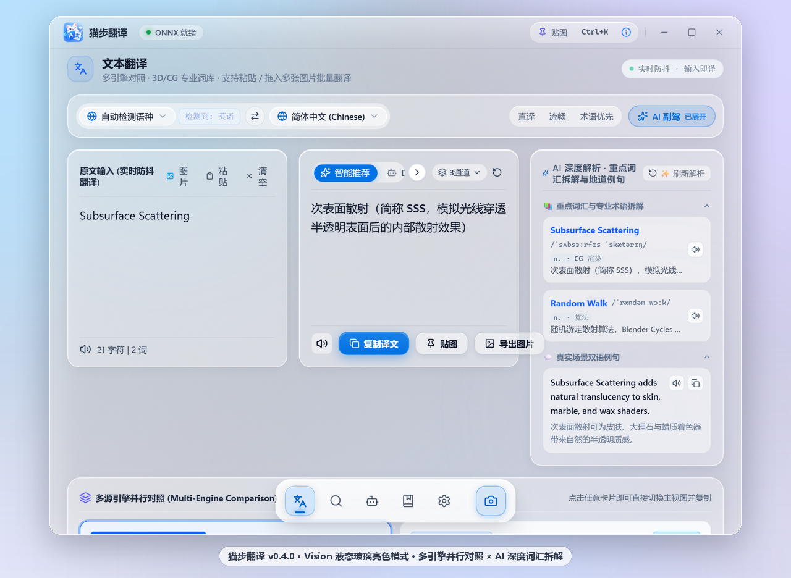
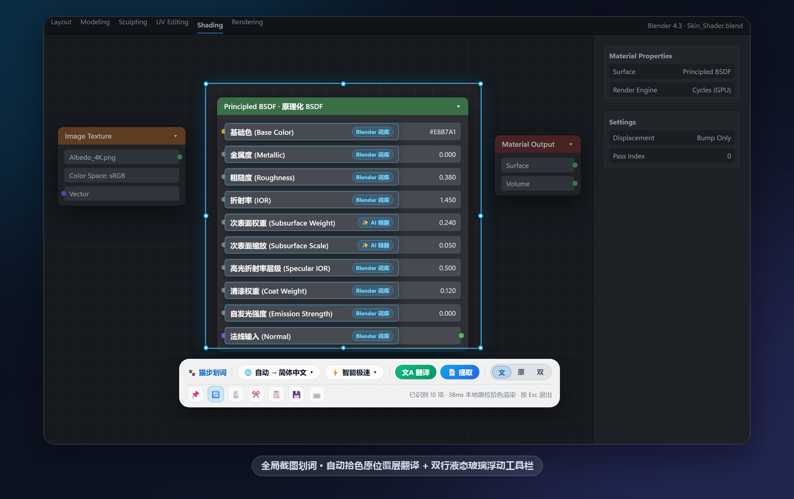
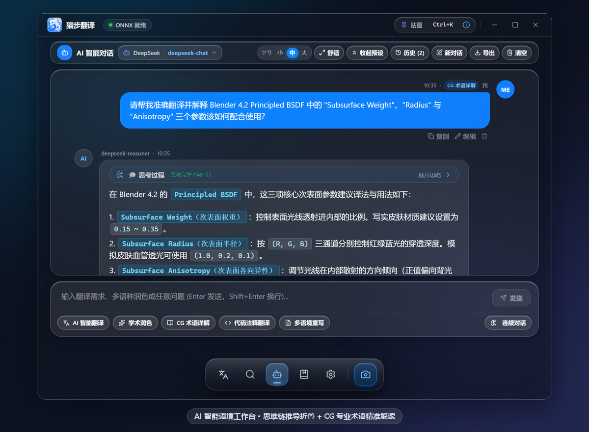
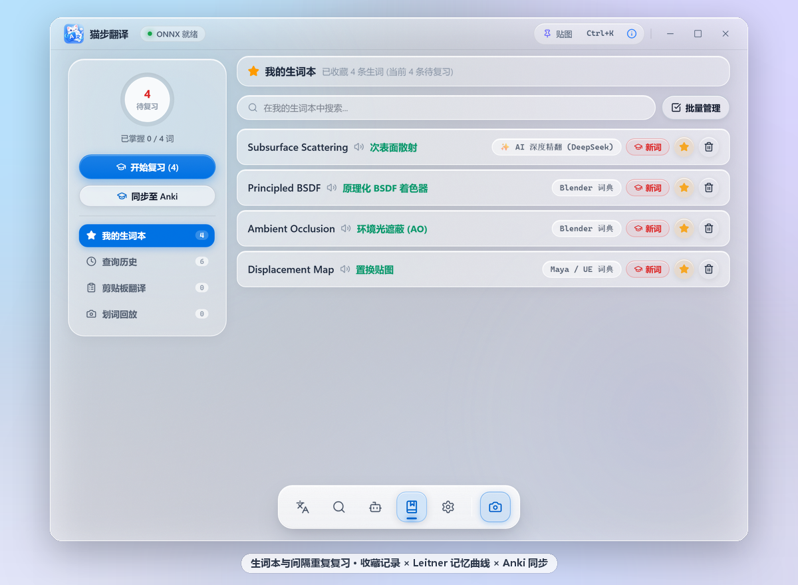
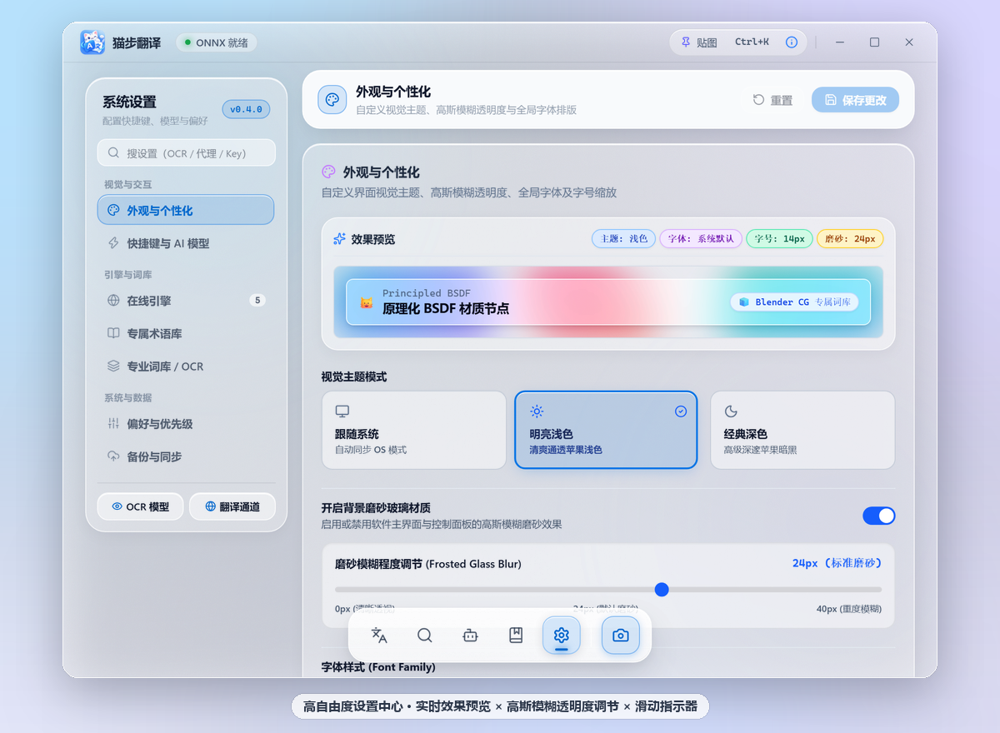
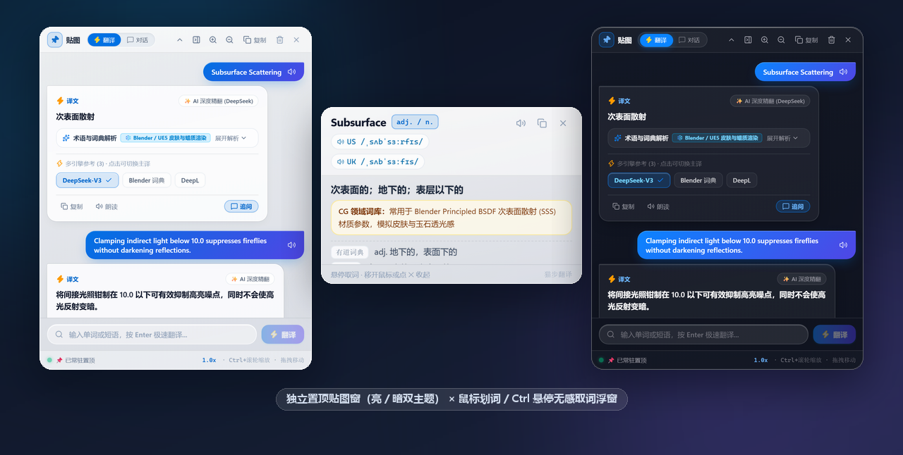
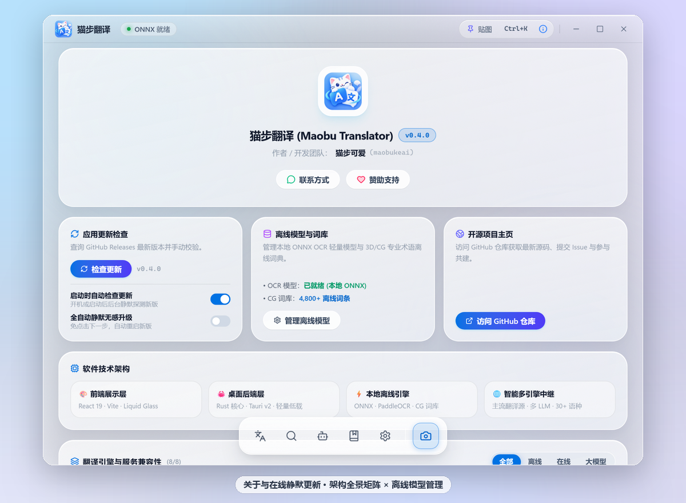

<div align="center">


<h1>🐾 猫步翻译 (Catwalk Translator)</h1>

<p><strong>专为 3D/CG 创作者、设计师、极客与重度桌面用户打造的新一代 Vision 液态玻璃 AI 截图划词翻译神器</strong></p>

<p>
  <a href="https://github.com/maobukeai/catwalk-translator/releases/latest">
    
  </a>
  
  
  
  
  
  <a href="./LICENSE">
    
  </a>
</p>

<p>
  <a href="#-界面预览">界面预览</a> •
  <a href="#-核心特性亮点">核心特性</a> •
  <a href="#-核心快捷键一览">快捷键一览</a> •
  <a href="#-下载与安装">下载与安装</a> •
  <a href="#-开发者本地构建指南">开发指南</a>
</p>

<br />

<!-- 根据 GitHub 访客系统的浅色 / 暗黑偏好自动切换 Hero 预览图 -->
<picture>
  <source media="(prefers-color-scheme: dark)" srcset="./docs/screenshots/hero-dark.png" />
  <source media="(prefers-color-scheme: light)" srcset="./docs/screenshots/hero-light.png" />
  
</picture>

</div>

---

## ✨ 界面预览

<table>
  <tr>
    <td width="50%" align="center">
      
      <br />
      <strong>📸 全局截图 · 自动拾色原位覆层翻译</strong>
      <br />
      <sub>框选 Blender / Maya / 文档界面，38ms 极速本地识别并与原 UI 背景无缝融色覆盖，搭载双行液态玻璃浮动工具栏。</sub>
    </td>
    <td width="50%" align="center">
      
      <br />
      <strong>🤖 AI 智能语境 · 思维链与术语精讲</strong>
      <br />
      <sub>支持 DeepSeek R1/V3、OpenAI、Gemini 与本地 Ollama，思维链自动折叠、斜杠预设与 CG 语境联动解析。</sub>
    </td>
  </tr>
  <tr>
    <td width="50%" align="center">
      
      <br />
      <strong>📚 生词本 · Leitner 记忆曲线与 Anki 同步</strong>
      <br />
      <sub>收藏词条、查询历史、剪贴板翻译与划词回放四大视图彻底解耦，内置间隔重复复习与 AnkiConnect 一键推送。</sub>
    </td>
    <td width="50%" align="center">
      
      <br />
      <strong>🎨 高自由度设置 · 实时毛玻璃与动效调节</strong>
      <br />
      <sub>亮/暗双主题、高斯模糊强度滑杆、全局字体排版、热键录制与统一弹性滑动指示器所见即所得。</sub>
    </td>
  </tr>
</table>

<details>
<summary>🔍 <strong>点击展开更多窗口形态预览：独立置顶贴图窗 × 悬停即译浮窗 × 关于与架构矩阵</strong></summary>
<br />
<div align="center">
  
  <p><sub>📌 <strong>独立置顶贴图窗（亮 / 暗双主题） × 无感划词 / 悬停浮窗</strong>：支持多引擎切换对比、滚轮缩放、贴边自动吸附及即时追问。</sub></p>
  <br />
  
  <p><sub>🚀 <strong>关于中心 &amp; 静默更新</strong>：实时展示 ONNX 离线引擎、4,800+ CG 专业词库与在线热更新状态。</sub></p>
</div>
</details>

---

## 🌟 核心特性亮点

1. **🧊 Vision 液态玻璃质感 &amp; 全站弹性滑动动效 (`v0.4.0` 全新升级)**
   * **全场景半透明毛玻璃**：统一主界面、独立贴图窗、悬停查词卡、AI 助手与截屏工具栏的视觉规范，智能自适应 **浅色 (Light)** 与 **暗黑 (Dark)** 系统主题。
   * **统一流体滑动指示器**：Dock 导航、语言选择、多引擎对比、术语筛选、风格切换与字号分段控件全量搭载弹簧物理滑动高亮与平滑过渡动效。
   * **高 DPI 像素级精确映射**：完美兼容 Windows 100%、125%、150%、200% 及多显示器混拼缩放，框选框与原位译文零偏移。

2. **⚡ 毫秒级原生 + 本地离线 OCR 引擎**
   * **本地 ONNX PP-OCRv6**：内置 Tiny / Small / Medium 多档轻量离线模型，支持设置页一键下载切换，断网亦能毫秒出字。
   * **Windows 原生 OCR 免依赖**：开箱即用直连系统 WinRT OCR，零模型下载体积即可完成高精度截屏识别。
   * **原位背景拾色覆层**：自动采样截图区块周边像素色值渲染译文盖层，提供 **译文 / 原文 / 双语** 一键切换、置顶贴图与直接保存成图。

3. **🧠 快慢双流渐进翻译 &amp; AI 智能副驾**
   * **极速首屏 + AI 慢通道精修**：在线多引擎（DeepL、Bing、Google、有道、百度）与本地专业词库秒级抢跑呈现，大模型（DeepSeek-V3/R1、OpenAI、Claude、Gemini、Ollama）随后自动在背景完成语境精译与词汇拆解，无缝平滑升级。
   * **AI 深度解析与对话工作台**：划词或输入文本自动拆分重点词汇、音标与双语场景例句；支持连续多轮追问、推理思考折叠展示与 Prompt 预设模板。

4. **🎮 3D/CG 垂直领域词库与独立生词复习闭环**
   * **主流 DCC / 引擎全覆盖**：深度预置 **Blender、Unreal Engine、Unity、Maya、Substance Painter、Houdini** 专业节点与着色器术语库，告别“生硬直译”。
   * **Leitner 间隔重复 + Anki 联动**：内置收藏词本、Leitner 五阶记忆复习系统与批量管理，支持通过 AnkiConnect 推送或导出 `.apkg` / TXT。

5. **📌 桌面贴图、无感取词与全自动静默更新**
   * **多端小窗联动**：支持快捷键唤起 `Ctrl+K` 桌面置顶贴图查词窗、`Alt+Space` Spotlight 全局快查框，以及鼠标划词 / `Ctrl` 悬停无感译词浮窗。
   * **WebDAV 同步 &amp; 静默更新**：支持个人词库/设置备份至本地或 WebDAV 云端，并在后台自动检测 GitHub Releases 完成静默更新安装。

---

## ⌨️ 核心快捷键一览

| 快捷键 | 功能说明 | 可自定义 |
| :--- | :--- | :---: |
| **`F4`** | 发起全屏区域框选截图 OCR 与原位翻译（支持长按/切换模式） | ✅ |
| **`Alt + Space`** | 呼出 Spotlight 悬浮全局查词输入框 | ✅ |
| **`Alt + Q`** | 显示 / 隐藏猫步翻译主窗口 | ✅ |
| **`Alt + W`** | 呼出桌面快捷贴图小窗（`PinQuick`） | ✅ |
| **`Ctrl + 按住悬停`** | 鼠标悬停屏幕任意英文单词触发无感查词浮窗 | ✅ |
| **`Esc` / 右键** | 快速退出截图覆盖层或收起当前弹窗 | — |

---

## 📦 下载与安装

1. 前往本仓库右侧 [**Releases 页面**](https://github.com/maobukeai/catwalk-translator/releases/latest) 下载最新版本（当前推荐 **`v0.4.0`**）：
   | 安装包文件 | 格式说明 | 适用场景 |
   | :--- | :--- | :--- |
   | `猫步翻译_0.4.0_x64-setup.exe` / `MaobuTranslator_0.4.0_x64-setup.exe` | NSIS 标准安装向导 | 大多数 Windows 10/11 (x64) 用户首选，支持自启动与静默更新 |
   | `猫步翻译_0.4.0_x64_zh-CN.msi` | Windows MSI 安装包 | 企业部署或习惯 MSI 标准安装流程的用户 |
   | `猫步翻译_0.4.0_x64_portable.exe` | 单文件绿色便携版 | 免安装即点即用，适合 U 盘或临时工作站环境 |
2. 启动后可在左下角 **「设置」→「快捷键与 AI 模型」** 中填入 DeepSeek / OpenAI / Gemini 或本地 Ollama 服务地址与 API Key，并按需下载 ONNX PP-OCRv6 离线识别模型以开启最佳体验。

---

## 🛠️ 开发者本地构建指南

### 环境依赖
* **Node.js** `>= 18.x` &amp; **pnpm** `>= 9.x`
* **Rust 工具链** (`cargo`, `rustc` via [rustup](https://rustup.rs/))
* **Windows 平台要求**：Visual Studio Build Tools 2022（C++ 桌面开发组件）与系统自带 WebView2 Runtime

### 开发与构建命令

```bash
# 1. 克隆仓库并进入桌面端工作区
git clone https://github.com/maobukeai/catwalk-translator.git
cd catwalk-translator/app_v2

# 2. 安装前端依赖
pnpm install

# 3. 启动热重载开发服务器（同时拉起 Tauri Rust 核心与前端界面）
pnpm tauri dev

# 4. 运行 TypeScript 检查与前后端单元测试
npx tsc --noEmit
pnpm test --run
cargo test --manifest-path src-tauri/Cargo.toml --lib

# 5. 构建 Windows 生产级安装包（NSIS / MSI）
pnpm tauri build
```

---

## 📄 开源协议

本项目基于 [**MIT License**](./LICENSE) 开源许可发布。欢迎提交 Issue 反馈问题或发起 Pull Request 共同完善工具！
